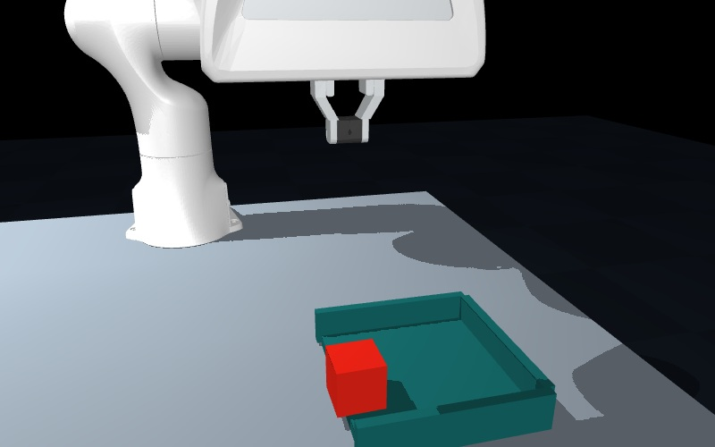
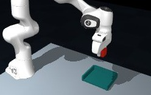
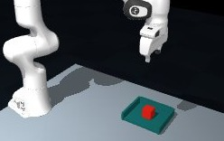

# ReachBench

MuJoCo에서 Franka Panda가 큐브를 집어 트레이에 놓는 시뮬레이션이다. 물체가 가려지거나 옆으로 밀렸을 때, 다시 관찰하고 집기를 재시도하면 결과가 어떻게 달라지는지 비교한다.

[재시도 켬·끔 비교](https://reachbench-vision-control.ykh13571.chatgpt.site/retry/?event=grasp) · [브라우저 실험](https://reachbench-vision-control.ykh13571.chatgpt.site/) · [160회 평가](#시뮬레이션-평가)

| 첫 집기 실패 · 6.31초 | 두 번째 집기 · 12.51초 | 배치 완료 · 17.56초 |
|---|---|---|
|  |  |  |

같은 시작 배치(seed 107)의 실행 기록이다. 첫 사진은 재시도를 끈 실행의 종료 자세다. 둘째와 셋째 사진은 재시도를 켠 실행의 자세이며, 두 번째 집기 사진은 판정 직전인 12.50초에 해당한다.

## 재시도 비교 42회

윤기혁은 기존 Python 제어기에 재시도 설정을 추가했다. 첫 집기 실패 후 이 설정을 확인하도록 분기를 바꾸고, 결과 파일에도 설정값을 남겼다. Codespaces에서 같은 시작 배치를 두 번씩 실행해 재시도 효과를 비교하고, 모터 명령과 실제 관절·집게 상태를 대조했다.

| 시작 배치 | 재시도 끔 | 재시도 켬 |
|---|---|---|
| 기존 실패 사례 · seed 107 | 6.31초에 빈손으로 종료 | 두 번째 집기 성공, 17.56초에 배치 완료 |
| 별도 평가 · seed 200–219 | 20/20 배치 성공 | 20/20 배치 성공, 재시도 0회 |

[42회 원본·실행 방법](docs/v3/retry-study/README.md) · [실행별 결과 CSV](docs/v3/retry-study/runs.csv) · [관측·관절·모터 기록](docs/v3/retry-study/ALIGNMENT.md)

## 시뮬레이션 평가

개발 seed 10–14와 별도로 최종 seed 100–119를 사용했다. 네 조건에서 같은 초기 배치를 두 방법으로 실행했다. 전체 160회이며 기준은 단일 관찰, 개선 방법은 추가 관찰과 최대 한 번의 재시도를 사용한다.

| 조건 | 단일 관찰 | 추가 관찰·재시도 |
|---|---:|---:|
| 기본 집기 | 20/20 | 20/20 |
| 목표 가림 | 0/20 | 20/20 |
| 관찰 후 위치 변화 | 0/20 | 20/20 |
| 작업 범위 밖 | 0/20 | 0/20 |
| **전체 배치 성공** | **20/80 (25%)** | **60/80 (75%)** |

평가에서 로봇과 가림판의 접촉은 0건이었다. 기본 작업대, 제어기, 공개 데모와 160회 평가는 Codex가 구현·수행했다. [실험 설계와 실패 유형](docs/v3/EXPERIMENT.md) · [실행 데이터](dist/bench/episodes.json) · [집계](dist/bench/summary.json) · [평가 설정](dist/bench/config.json)

### 후속 검증

- **어두운 입력에서의 배치.** 시작 배치 12곳에서 원본 밝기와 RGB 밝기 35%를 비교했다. 어두운 조건에서는 고정 밝기 기준으로 7/12, 밝기에 맞춰 기준을 조정했을 때 12/12 배치에 성공했다. 큐브가 없는 장면에서 트레이를 빨갛게 만들자 두 방법 모두 트레이를 큐브로 검출했다. [48회 실행과 대조 조건](docs/v3/low-light/README.md)
- **ROS 2 기록 재생.** Jazzy에서 seed 107의 카메라와 관절 기록을 표준 메시지로 발행했다. 독립 프로세스에서 수신한 449개 메시지의 시각과 데이터를 원본과 대조했다. [ROS 2 bag과 재현 명령](docs/v3/ros2/README.md)

두 후속 검증은 Codex가 수행했다. 밝기 보정은 Python에서 실행할 수 있으며 ROS 2는 저장된 센서·관절 기록을 재생한다. 실물 환경과 로봇 정책 학습은 별도 검증이 필요하다.

## 실행

### 브라우저

**실험 실행**을 누르면 브라우저에서 MuJoCo 물리를 계산한다. 평가 표에서 사례를 열면 별도 Python 실행 기록을 재생하며 `PYTHON / RECORDED`로 표시된다. 실시간 3D가 열리지 않으면 **기록으로 두 실행 비교하기**에서 seed 107 비교를 열 수 있다. [공개 데모](https://reachbench-vision-control.ykh13571.chatgpt.site/) · [공개 화면 검증 기록](docs/v3/retry-study/README.md#기록-비교-화면)

로컬에서 정적 사이트를 열려면 저장소 루트에서 다음 명령을 실행하고 `http://localhost:8000`으로 접속한다.

```bash
python -m http.server 8000 --directory dist
```

### Python 시뮬레이션

Python 3.11과 MuJoCo 4.0.1을 사용한다. 아래 명령은 Linux x86-64와 Mesa/EGL 환경 기준이다.

```bash
python3.11 -m venv .venv
source .venv/bin/activate
pip install -r requirements-manipulation.txt
export MUJOCO_GL=egl
python -m manipulation.controller --seed 100 --condition occluded --method feedback --out work/my-run
python -m manipulation.evaluate --split eval --out work/eval --workers 3
```

개발 배치 평가에는 `--split dev`를 사용한다. seed 107의 두 설정을 재현하는 명령은 [재시도 비교 문서](docs/v3/retry-study/README.md#시뮬레이션-재현)에 있다.

### 빌드와 테스트

배포용 브라우저 자산을 다시 만들 때는 위 Python 환경에서 Node.js 20 이상을 사용한다.

```bash
npm ci
python -m scripts.build_studio
npm run check
npm run test:ui
```

전체 Python 테스트에는 보존된 PyBullet 실험도 포함된다. Linux에서는 위에서 설정한 EGL 환경에서 실행한다.

```bash
pip install -r requirements.txt
python -m pytest -q
```

선택 사항인 브라우저 자동 검증에는 `requirements-browser.txt`와 시스템 Chromium이 필요하다. 정적 서버를 실행한 다음 `python tests/browser_studio.py --url http://localhost:8000 --out work/browser`를 실행한다. [브라우저 검증 기록](docs/v3/VALIDATION.md)

## 코드와 데이터

- `manipulation/` — RGB-D를 바탕으로 목표 XY를 추정하고 역기구학으로 팔을 움직인다. 들어 올린 뒤 손가락 간격으로 집기를 판정한다. 물체의 정답 위치는 평가에 사용한다.
- `dist/bench/` — 대표 실행의 관절 상태와 모터 명령은 JSON, 거리·카메라 파라미터는 NPZ에 있다. [윤기혁이 작성한 RGB-D 검사 도구](docs/v3/RGBD_VALIDATION.md)
- `dist/legacy/` — 초기 PyBullet 접근과 카메라 보정 실험이다. [초기 결과](docs/RESULTS.md) · [보정 결과](docs/v2/RESULTS.md)
- `manipulation/assets/panda/` — MuJoCo Menagerie의 Franka Panda 모델이다. [출처와 라이선스](docs/v3/LICENSES.md)
