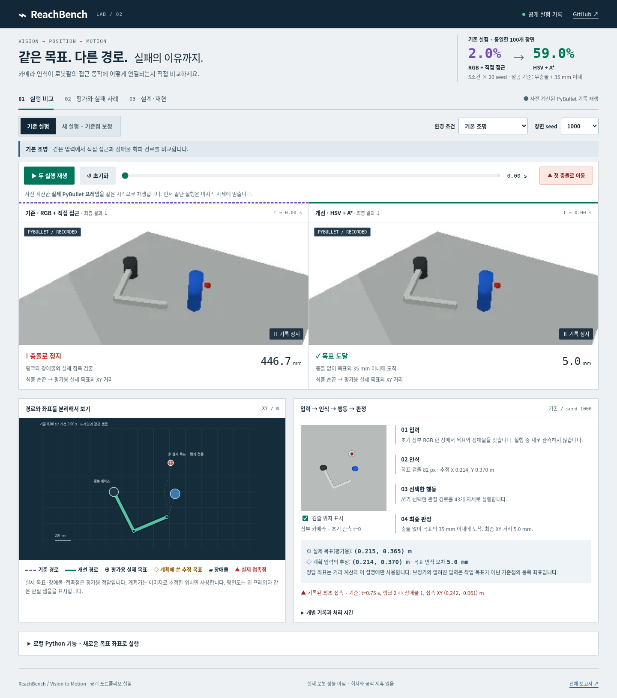

# ReachBench · Vision to Motion

[공개 데모](https://reachbench-vision-control.ykh13571.chatgpt.site/) · [새 실험 결과](docs/v2/RESULTS.md) · [전체 보고서](https://reachbench-vision-control.ykh13571.chatgpt.site/report.html) · [기여·면접 안내](docs/INTERVIEW.md)

카메라 인식 → 위치 추정 → 경로 계획 → 목표 접근 → 평가를 연결하는 CPU 로봇팔 실험. 투모로로보틱스 Physical AI / Robotics R&D 인턴 업무 중 시뮬레이션·센서 인식·공간 정보와 동작 연계·데이터 검증을 보여준다.



공개 데모는 **사전 계산한 실제 PyBullet 실행의 프레임 재생기**다. 로그와 일치하는 재실행에서 렌더링한 프레임이며 2D 경로도 같은 관절 샘플을 표시한다. 새 계산은 로컬 Python에서 지원한다. 실물 로봇, 모터 동역학 제어, 파지·놓기, ROS 2, 보행/WBC, 학습 정책 결과가 아니다.

**Codex가 조사·설계·구현·평가·테스트·문서화·배포를 수행했다. 사용자는 요구사항을 정하고 GitHub 저장소를 생성했다.** 본인이 직접 재현·수정한 부분만 이후 자신의 기여로 기록한다.

## 1분 체험

1. 기본 화면의 **두 실행 재생**을 눌러 RGB 직접 접근과 HSV+A*의 실제 움직임을 비교한다. **첫 충돌로 이동**에서 접촉 시점과 2D 접촉점을 본다.
2. 환경 조건을 **목표 가림**으로 변경한다. 입력 패치 → 검출 없음 → 이동 보류를 확인한다. 표시된 거리는 이동하지 않은 시작 손끝과 실제 목표 사이 거리다.
3. **보정 오차 +65 mm** → **이 실패를 개선한 실험 보기**로 이동한다. 실제 목표와 추정 위치를 구분하고 기준점 보정 전·후를 비교한다.
4. 새 실험에서 기준점 결손/오배치를 선택하고, **평가와 실패 사례**에서 실패 기록을 바로 연다.

[모바일 실제 캡처](dist/screenshots/mobile-comparison.png) · [보정 비교 화면](dist/screenshots/desktop-calibration.png)

## 실제 결과

원본 400회(100장면 × 4방법)를 보존했다. RGB+직접 접근 2/100, HSV+직접 접근 3/100, RGB+A* 39/100, HSV+A* 59/100. [기존 결과](docs/RESULTS.md).

새 실험은 **HSV+A* 대 기준점 보정+HSV+A***를 같은 RGB·시작 자세·계획기로 비교했다. 개발 seed 2000–2002의 42회와 분리한 최종 seed 3000–3019의 280회다. 성공은 무충돌·경로 존재·최종 XY 거리 ≤35 mm.

| 조건 | 성공 기존 → 보정 | 충돌 기존 → 보정 | 인식 평균 오차 기존 → 보정 |
|---|---:|---:|---:|
| 정상 기준점, 0/20/40/65/100 mm 편향 전체 | 40/100 → 100/100 | 39 → 0 | 46.36 → 2.29 mm |
| 정상 기준점, +65 mm만 | 0/20 → 20/20 | 18 → 0 | 65.03 → 2.29 mm |
| 기준점 2개, +65 mm | 0/20 → 0/20 | 18 → 0 | 보정 보류 |
| 기준점 전체 +50 mm 오배치, +65 mm | 0/20 → 0/20 | 18 → 0 | 65.03 → 50.84 mm |

기준점 위치가 알려져 있다는 가정 아래 공통 XY 편향을 영상 관측으로 추정한다. 기준점이 틀리면 잔차가 작아도 보정은 틀릴 수 있다. 정상/스트레스 전체로는 40/140 → 100/140이며 **100%는 정상 기준점 100장면에만 해당한다.** 기존 59%와 새 100%는 조건·seed가 달라 직접 개선 폭으로 비교하지 않는다. 학습·데이터 증강은 수행하지 않았다.

## 설치·로컬 실행

Python 3.11 권장. 실제 검증 환경은 Linux x86_64, CPython 3.11.18, PyBullet 3.2.7, OpenCV 4.11.0.86, NumPy 2.2.6. GPU·모델 키·계정·GUI 불필요.

```bash
git clone https://github.com/sokldjs554/reachbench.git
cd reachbench
python3.11 -m venv .venv
source .venv/bin/activate
python -m pip install -r requirements-dev.txt
python -m reachbench.serve
```

http://127.0.0.1:8000 → **로컬 Python 기능 · 새로운 목표 좌표로 실행**. 목표 X/Y를 바꾸면 원 RGB/HSV 비교를 실제 새로 계산하고 프레임을 생성한다. 로컬 결과는 평가 집계에 추가하지 않는다. 서버는 localhost 전용·순차 처리다. Windows는 `.venv\Scripts\activate`; 다른 OS는 미검증. Python 3.12에서 PyBullet 소스 빌드가 필요할 수 있다.

## 재현·검증

```bash
python -m pytest -q
# 원 공개 결과를 덮어쓰지 않는 전수 재현 검사
PYTHONPATH=. python scripts/reproduce_v2.py
# 별도 폴더로 최종 평가와 실제 프레임 생성
python -m reachbench.calibration --start 3000 --count 20 --split evaluation --record --out work/my-evaluation
npm ci
npm run check
npm run test:ui
# 선택: 실제 Chromium 데스크톱·모바일 흐름 검사
python -m pip install -r requirements-browser.txt
python -m playwright install chromium
python scripts/browser_qa.py
```

21개 Python 테스트, 최종 280회 전수 재실행 일치, 원본 기준/개선 200회 재실행 일치, 총 480개 실행의 프레임/trace/접촉 정합성을 확인했다. Chromium 1440×1000과 390×844에서 주요 흐름과 실제 렌더링을 검사했다. 실제 휴대전화·Safari·외부 사용자 테스트는 하지 않았다. [상세 프로토콜](docs/v2/EXPERIMENT.md) · [브라우저 기록](docs/v2/browser-validation.json) · [전수 재현 기록](docs/v2/reproduction.json).

정적 배포는 `dist/`를 게시한다. 공개 데모에서 새 Python 계산은 지원하지 않는다. 보고서/ZIP 재생성: `python scripts/build_report.py`, `python scripts/package_source.py` (로컬 ZIP은 `work/`에 생성). 공개 ZIP 링크는 GitHub의 전체 소스 아카이브를 사용한다.

## 코드·데이터

- `reachbench/sim.py`: 변경하지 않은 원 엔진, 카메라/인식/FK/IK/A*/기구학 실행
- `reachbench/calibration.py`: RGB 기준점 관측, 편향 추정, paired 평가
- `reachbench/recording.py`: 실제 PyBullet 프레임·접촉점·trace index와 해시
- `reachbench/serve.py`: 로컬 새 좌표 계산과 프레임 생성
- `dist/data/`: 원본 400회 불변 기록 / `dist/media/legacy/`: 기준/개선 200회 재실행 프레임
- `dist/data-v2/`: 최종 280회 JSON/CSV/입력 RGB/집계/프레임
- `docs/v2/development/`: 분리한 개발 42회 기록
- `docs/v2/RESEARCH.md`: 공고·참고 사례·개선 방향 판단
- `docs/v2/EXPERIMENT.md`: 설정·수식·재현·오차와 시간 정의
- `docs/THIRD_PARTY.md`: 출처·라이선스. 외부 모델·로봇 자산·영상 복사 없음
