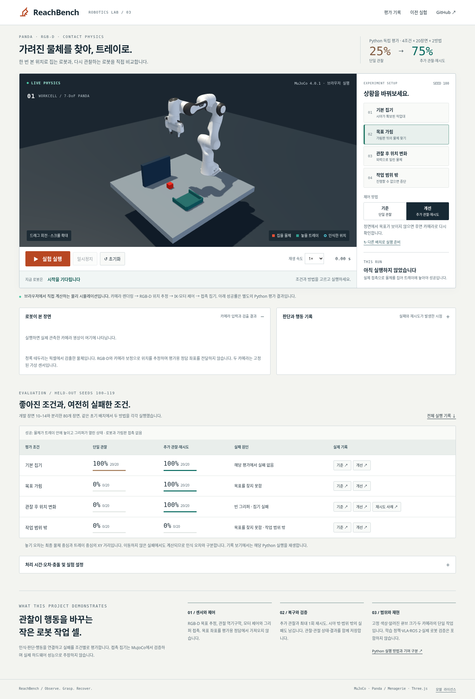

# ReachBench — Observe. Grasp. Recover.

**가림과 위치 변화가 있는 작업대에서, 카메라로 물체를 찾아 집고 트레이에 놓는 로봇 실험.**

[공개 데모](https://reachbench-vision-control.ykh13571.chatgpt.site/) · [실험·한계](docs/v3/EXPERIMENT.md) · [18개 프로젝트 비교 조사](docs/v3/RESEARCH.md)



첫 화면의 **실험 실행**을 누르면 브라우저에서 MuJoCo 물리를 직접 계산한다. `목표 가림 → 개선`을 실행한 다음 **같은 배치에서 기준 방법 실행**으로 비교할 수 있다. 평가 표의 기록은 별도 Python 실험을 재생하며 화면에 `PYTHON / RECORDED`로 표시한다. Chrome/Edge 최신 버전 권장; 첫 로딩은 WASM 약 11 MB와 압축 모델 약 15 MB가 필요하다.

## 실제 구현

Python MuJoCo 4.0.1 + Franka Panda, 두 고정 RGB-D 카메라, HSV 분할·depth 역투영, 감쇠 최소제곱 IK, 관절 모터 추종, 물리 접촉 그리퍼, 추가 관찰·최대 1회 집기 재시도, 같은 장면의 기준/개선 평가. 큐브를 로봇에 강제로 붙이는 제약이나 실행 중 관절 순간이동은 사용하지 않는다. 리셋과 **기록 재생**은 저장된 자세를 설정한다.

입력 픽셀 → 카메라 보정에 따른 XY 추정 → 접근·집기·운반·놓기 → 트레이 배치 판정이 연결된다. 정답 위치는 평가·시나리오 생성에만 사용한다. 알려진 44 mm 큐브와 테이블 높이를 이용하는 제한된 위치 추정이며 범용 물체 인식·6D 자세 추정은 아니다.

## 독립 평가 결과

개발 seed 10–14, 최종 seed 100–119. 4조건 × 20장면 × 2방법 = **160회**. 동일 조건·초기 배치로 비교했다.

| 조건 | 단일 관찰 | 추가 관찰·재시도 |
|---|---:|---:|
| 기본 집기 | 20/20 | 20/20 |
| 목표 가림 | 0/20 | 20/20 |
| 관찰 후 위치 변화 | 0/20 | 20/20 |
| 작업 범위 밖 | 0/20 | 0/20 |
| 전체 | **20/80 (25%)** | **60/80 (75%)** |

이 수치는 정해진 네 조건의 Python 시뮬레이션 결과다. 가림판 접촉은 모두 0회였고, 범위 밖 실패 20회는 개선 후에도 남았다. 성공률 개선은 추가 관찰과 재시도를 **합친 방법**의 효과다. [전체 160회 기록](dist/bench/episodes.json), [집계](dist/bench/summary.json), [설정·소스 해시](dist/bench/config.json)를 공개한다.

재관측을 유지하고 재시도만 바꾼 후속 실험에서 seed 107은 실패에서 배치 성공으로 바뀌었다. 별도 평가 seed 200–219는 두 설정 모두 20/20 성공했고 재시도가 발동한 사례는 0건이었다. [42회 원본·재현 방법](docs/v3/retry-study/README.md).

학습·증강 효과 실험, VLA, ROS 2, 하드웨어 검증은 수행하지 않았다. 회사의 로봇 파운데이션 모델을 구현한 프로젝트가 아니다.

## 실행과 재현

Python 3.11, Linux x86-64, CPU 물리 + Mesa/EGL 오프스크린 렌더링에서 실행했다. Linux에서는 EGL/OpenGL 시스템 라이브러리가 필요하다. GPU·API 키·유료 서비스는 필요 없다.

```bash
python3.11 -m venv .venv
source .venv/bin/activate
pip install -r requirements-manipulation.txt
# Linux headless; 데스크톱 macOS에서는 MUJOCO_GL=glfw 등 환경에 맞게 선택
export MUJOCO_GL=egl
python -m manipulation.controller --seed 100 --condition occluded --method feedback --out work/my-run
python -m manipulation.evaluate --split dev --out work/dev --workers 3
python -m manipulation.evaluate --split eval --out work/eval --workers 3
```

평가 출력은 `work/`에 생성해 공개 원본을 덮어쓰지 않는다. 벽시계 시간은 호스트·부하에 따라 달라진다. 공개 웹은 정적 파일만으로 실행한다.

```bash
python -m http.server 8000 --directory dist
# http://localhost:8000
```

배포 자산을 다시 빌드하려면 Node.js 20+에서:

```bash
npm ci
python -m scripts.build_studio
npm run check
```

검증:

```bash
pip install -r requirements.txt   # 보존된 PyBullet 실험 테스트용
python -m pytest -q
npm run test:ui
pip install playwright
# 시스템 Chromium 필요. 다른 설치 경로라면 tests/browser_studio.py의 executable_path 조정
python tests/browser_studio.py --url http://localhost:8000 --out work/browser
```

[실제 검증 기록](docs/v3/VALIDATION.md). 브라우저와 Python은 같은 물리 모델·제어 구조를 사용하지만 렌더러·수치 연산·시간 분할이 다르므로 결과가 완전히 같지는 않다.

RGB-D 파일의 이미지 크기와 유효 깊이 비율을 검사하려면:

```bash
python -m manipulation.check_rgbd dist/bench/runs/shifted-107-feedback/camera-1.npz
python -m pytest -q tests/test_rgbd_validation.py
```

[검사 조건과 테스트 결과](docs/v3/RGBD_VALIDATION.md). 유효 깊이 비율은 인식 정확도가 아니다.

## 데이터와 구조

- `manipulation/`: 물리 작업대, RGB-D 인식, 제어기, 평가 실행.
- `dist/studio*.mjs`: 브라우저 센서·물리·UI. `studio-core.mjs`는 좌표 계산과 성공 판정.
- `dist/bench/`: 전체 결과와 대표 실행. RGB 원본·depth·보정 정보는 NPZ, 센서 미리보기는 JPG, 관절 상태·모터 명령·단계·시간은 JSON. 실패도 저장한다.
- `manipulation/assets/panda/`: Apache-2.0 모델 및 출처·파일 해시. [외부 자산](docs/v3/LICENSES.md).
- `dist/legacy/`: 이전 PyBullet 접근·보정 실험 UI. [기존 결과](docs/RESULTS.md), [보정 결과](docs/v2/RESULTS.md). 기존 데이터·엔진은 보존했다.

## 제작 도구

초기 구현·실험 실행·검증·문서화에 Codex를 사용했다. 외부 라이브러리와 로봇 모델의 출처·라이선스는 [외부 자산 문서](docs/v3/LICENSES.md)에 정리했다.
