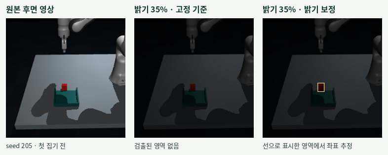

# 어두운 후면 영상과 집기 실패

기존 RGB-D 기록에서 어둡게 만든 후면 사진 여섯 장은 색상·채도 조건을 통과한 픽셀이 109–130개였지만, 밝기 조건(V > 60)을 통과한 픽셀이 한 개도 없었다. 기준 방법과 밝기 보정 방법으로 같은 사진을 검사하고, 별도의 위치 변화 장면에서는 실제 MuJoCo 제어기를 끝까지 실행했다.



## 어떤 기준을 바꿨나

기본 카메라 설정에서 개발 seed 10–14의 시작 자세를 렌더링했다. 각 영상에서 HSV 밝기(V)의 95백분위수는 정면 166, 후면 162였고, 열 장의 중앙값 164를 기준값으로 사용했다. 개선 방법은 매 관측에서 밝기 하한을 `clip(60 × 현재 V의 95백분위수 / 164, 18, 60)`으로 정한다. 색상·채도 조건, 잡음 제거, 깊이 역투영, 제어기와 재시도 조건은 같다. 검출기에 실험의 RGB 배율이나 큐브 정답 위치를 주지 않는다. 하한 18은 거의 검은 픽셀까지 선택하지 않기 위한 고정값이다.

## 기존 실패 재검사

알려진 seed 200–219의 기존 정면·후면 사진 40장에서 검사했다. 원본과 65% 밝기에서는 두 방법 모두 40/40장이었다. 35%에서는 기존 34/40, 보정 40/40이었다. 보정 방법이 좌표를 낸 40장의 평균 XY 오차는 2.95 mm였다. 기존 방법의 2.47 mm는 검출에 성공한 34장만의 평균이다. [기존 결과](../retry-study/rgb-brightness.csv) · [보정 결과](archive-adaptive.csv)

## 새 장면에서의 배치 결과

별도 seed **320–331**의 같은 초기 배치에서 큐브를 +Y 방향으로 2 N, 60 ms 동안 밀었다. 피드백 제어와 최대 한 번의 재시도를 두 방법에 공통 적용했다. 밝기는 센서의 RGB 채널에 곱하고 정수로 반올림했다. 깊이는 원래 값을 썼다. 12장면 × 2밝기 × 2방법을 실행했다. 배치 판정은 기존 실험의 물체 위치·높이·그리퍼 열림·가림판 접촉 조건을 사용했다.

| RGB 밝기 | 검출 방법 | 배치 성공 | 재시도 합계 | 로봇–가림판 접촉 | 종료 시 물체–트레이 평균 XY 거리 |
|---|---|---:|---:|---:|---:|
| 100% | 고정 | 12/12 | 0 | 0 | 2.86 mm |
| 100% | 밝기 보정 | 12/12 | 0 | 0 | 2.86 mm |
| 35% | 고정 | 7/12 | 5 | 0 | 44.98 mm |
| 35% | 밝기 보정 | 12/12 | 0 | 0 | 2.86 mm |

마지막 열은 실패를 포함한 전체 12회 평균이다. 35%에서 seed 327–331의 결과가 빈손 종료에서 배치 성공으로 바뀌었다. 예를 들어 327의 기존 방법은 1.96초 후면 재관측과 5.86초 재시도에서 모두 위치를 얻지 못했다. 보정 방법은 1.96초에 실제 큐브 중심에서 XY 거리 3.78 mm인 위치를 추정해 배치를 마쳤다. [실행별 결과](episodes.csv) · [모든 관측과 XY 정답](observations.jsonl)

## 큐브가 없는 경우

큐브를 시야에서 제거한 뒤 정면·후면과 두 밝기를 조합했다. 평소 색의 트레이에서는 두 방법 모두 0/4건에서 좌표를 냈다. 트레이 바닥을 큐브와 같은 빨간색으로 바꾸자 **두 방법 모두 4/4건에서 트레이를 큐브로 잘못 검출**했다. 빈 작업대는 seed가 바뀌어도 같은 구도이므로 각 카메라와 밝기를 한 번만 셌다. [음성 대조 결과](no-target.csv)

이 실험에서 바꾼 것은 디지털 RGB 밝기다. 센서의 자동 노출, 실내 조명에 따른 그림자·깊이 변화, 여러 색 물체의 식별은 별도 검증이 필요하다. 이번 보완 실험과 코드는 Codex가 수행했다. 지원자가 직접 수행한 42회 재시도 비교는 [별도 기록](../retry-study/README.md)에 있다.

## 실행

기본값은 기존 고정 검출기와 원래 RGB 밝기다. Python 시뮬레이션 명령은 [기존 환경](../../../requirements-manipulation.txt)에서 실행한다.

```bash
export MUJOCO_GL=egl
python -m manipulation.controller --condition shifted --method feedback --seed 327 --rgb-gain 0.35 --adaptive --out work/dark-327
python -m scripts.evaluate_low_light --out work/check-light
diff docs/v3/low-light/episodes.csv work/check-light/episodes.csv
diff docs/v3/low-light/observations.jsonl work/check-light/observations.jsonl
diff docs/v3/low-light/no-target.csv work/check-light/no-target.csv
```

기존 사진 40장은 [원본 압축 해제](../retry-study/README.md#원본-확인과-재집계) 후 다음과 같이 검사한다.

```bash
python -m scripts.evaluate_rgb_brightness work/retry-archive/work/retry-study --adaptive > work/check-light/archive-adaptive.csv
diff docs/v3/low-light/archive-adaptive.csv work/check-light/archive-adaptive.csv
```
